<div align="center">

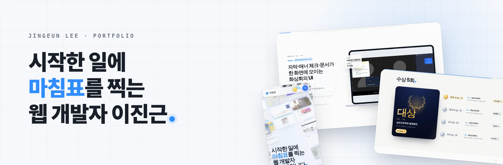

<br>

**시작한 일에 마침표를 찍는 웹 개발자, 이진근의 포트폴리오입니다.**

<a href="https://myportfolio-steel-delta.vercel.app"></a>

<br><br>


</div>

<br>

## 📌 소개

진행한 프로젝트를 **스크롤 한 번으로 이어지는 하나의 이야기**처럼 보여 주는 포트폴리오입니다.
화면 위를 따라다니는 파란 점(마침표)이 지금 볼 내용을 안내하고, 프로젝트를 누르면 상세 창에서 맡은 일·해결한 문제·화면을 확인할 수 있습니다.

<div align="center">
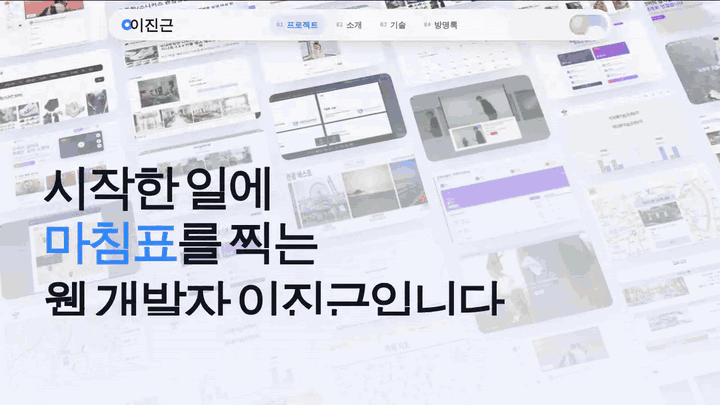
<br>
<sub>스크롤하면 장면이 이어지고, 파란 점이 다음 내용을 따라갑니다.</sub>
</div>

<br>

| 구분 | 내용 |
| :--- | :--- |
| 형태 | 1인 제작 포트폴리오 사이트 |
| 첫 공개 | 2025.07 |
| 현재 버전 | v3 (2026.10) |
| 제작 방식 | AI 도구를 활용해 제작 ([아래 설명](#-제작-방식)) |

<br>

## 🖼 화면

<table>
  <tr>
    <td width="50%">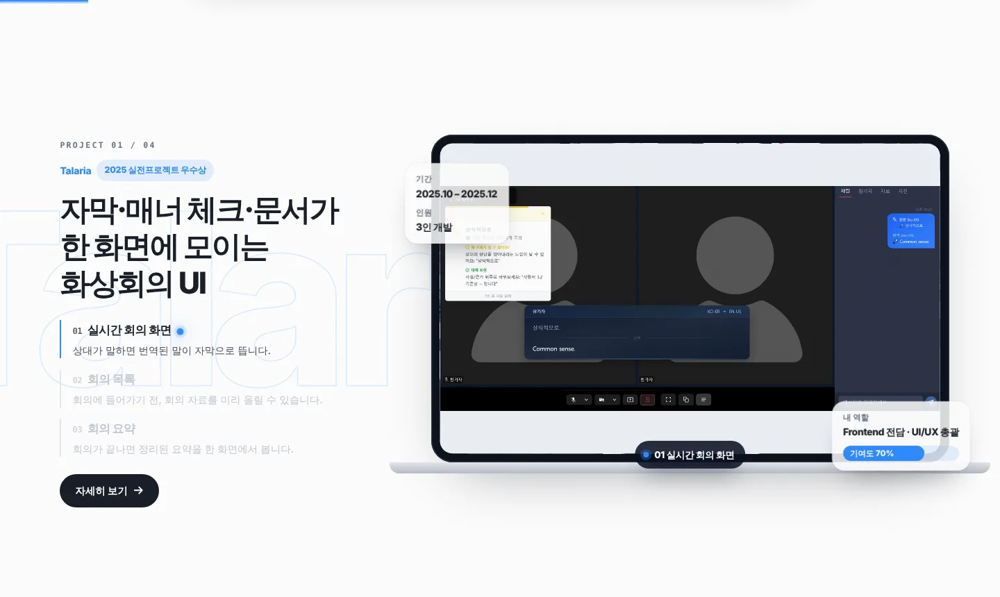</td>
    <td width="50%">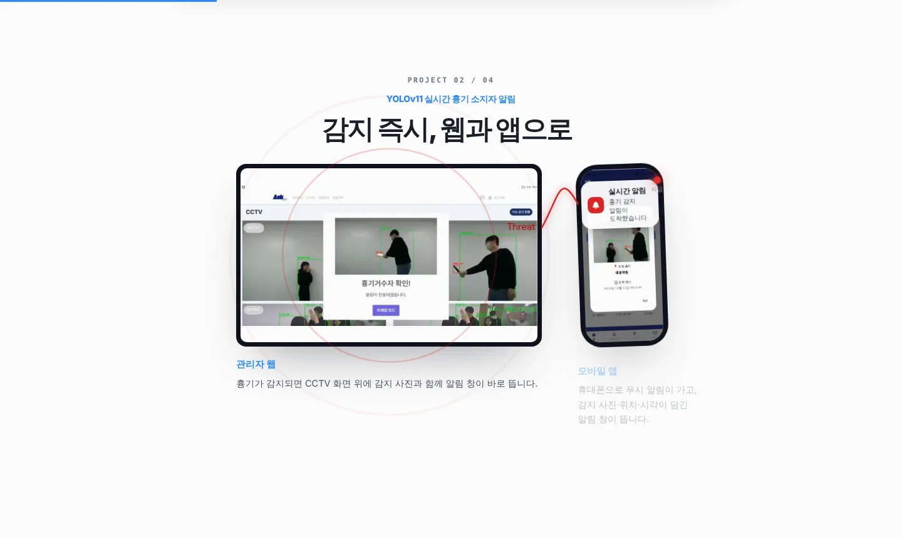</td>
  </tr>
  <tr>
    <td align="center"><b>프로젝트 소개</b><br><sub>노트북 화면 안에서 기능이 하나씩 바뀝니다</sub></td>
    <td align="center"><b>웹·앱 프로젝트</b><br><sub>웹 화면과 앱 화면을 함께 보여 줍니다</sub></td>
  </tr>
  <tr>
    <td>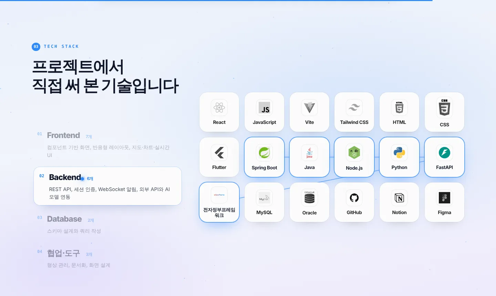</td>
    <td>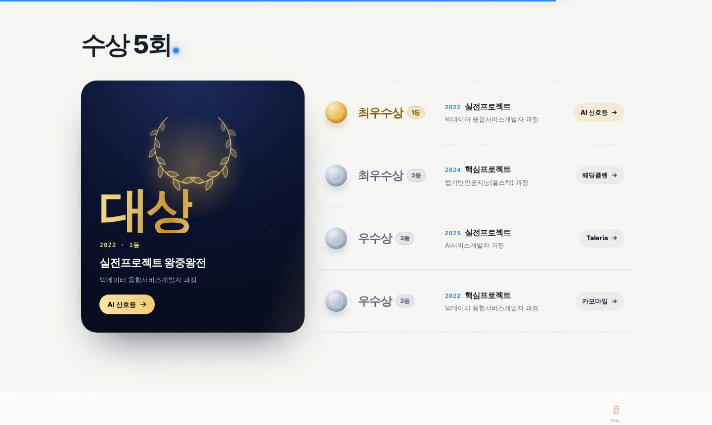</td>
  </tr>
  <tr>
    <td align="center"><b>기술</b><br><sub>분야별로 쓴 기술이 차례로 켜집니다</sub></td>
    <td align="center"><b>수상</b><br><sub>실제 순위에 맞춰 메달 색을 나눴습니다</sub></td>
  </tr>
</table>

<div align="center">
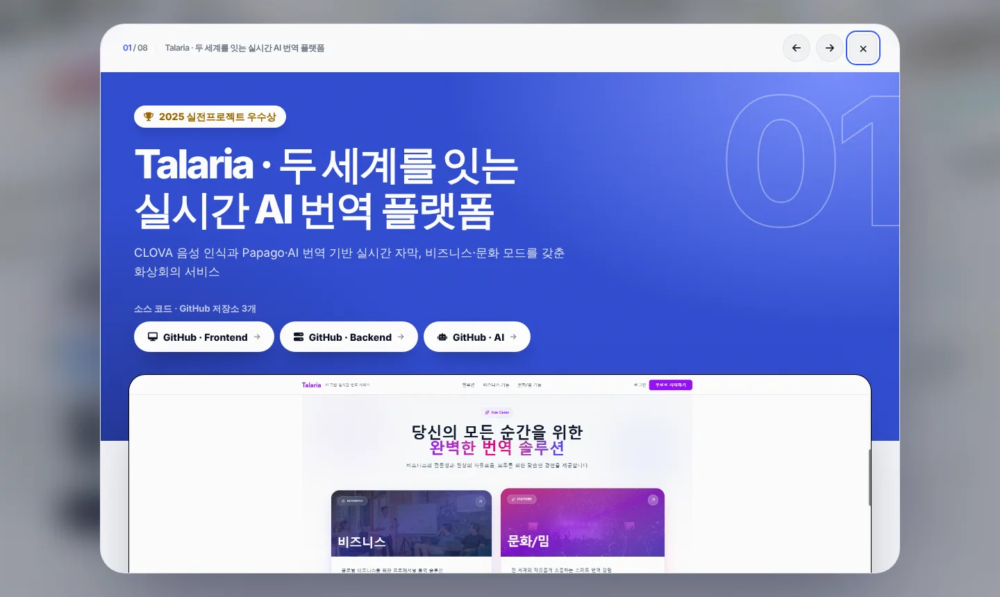
<br>
<sub><b>프로젝트 상세 창</b> — 담당 기능, 해결한 문제, 요구사항 대응, 화면 갤러리</sub>
</div>

<br>

<div align="center">
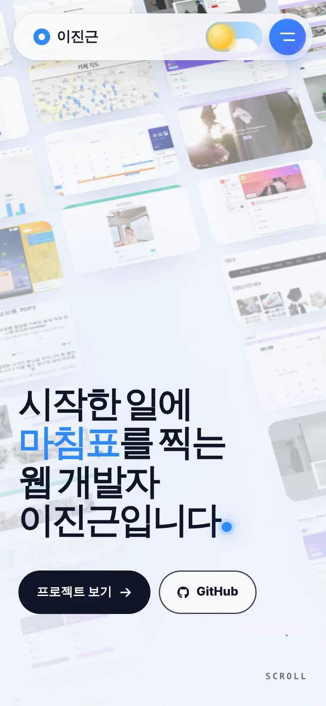
&nbsp;&nbsp;&nbsp;
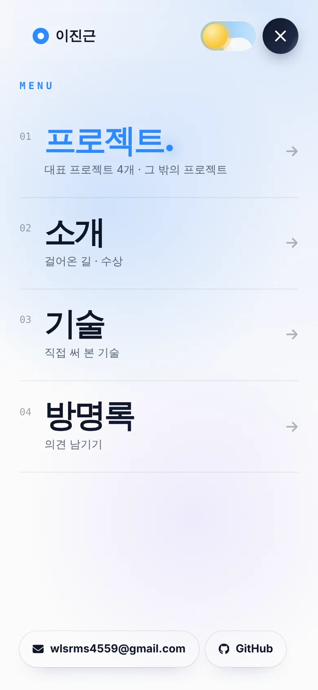
<br>
<sub><b>모바일</b> — 메인 화면과 전체 화면 메뉴</sub>
</div>

<br>

## ✨ 주요 기능

| 기능 | 설명 |
| :--- | :--- |
| 🎬 스크롤 스토리 | 메인 → 프로젝트 → 소개 → 기술 → 방명록이 끊기지 않고 한 흐름으로 이어집니다 |
| 🔵 마침표 길잡이 | 화면에 고정된 점이 섹션마다 지금 봐야 할 요소를 따라갑니다 |
| 🗂 프로젝트 상세 창 | 담당 기능, 해결한 문제, 요구사항 대응, 화면 갤러리를 데이터로 그립니다 |
| 🏆 수상 섹션 | 1등·2등에 맞춰 메달 색을 나누고, 누르면 관련 프로젝트로 이동합니다 |
| 💬 방명록 | Firebase Firestore로 남긴 글이 실시간으로 보입니다 |
| 🌗 라이트·다크 모드 | 모드마다 색을 따로 지정했습니다 |
| 📱 반응형 | 데스크톱·태블릿·모바일마다 배치가 바뀌고, 모바일은 전체 화면 메뉴를 씁니다 |

<br>

## 🛠 기술 스택

| 분류 | 사용 기술 |
| :--- | :--- |
| 프레임워크 | React 19, Vite |
| 스타일 | Tailwind CSS v4 |
| 애니메이션 | GSAP (ScrollTrigger), Motion, Lenis(부드러운 스크롤) |
| 데이터 | Firebase Firestore (방명록) |
| 기타 | Embla Carousel, React Icons, Vercel Analytics |
| 배포 | Vercel |

<br>

## 🔧 구현 포인트

<details open>
<summary><b>1. 화면 크기마다 다른 스크롤 장면</b></summary>
<br>

스크롤에 고정(pin)되는 장면은 `gsap.matchMedia`로 넓은 화면과 좁은 화면의 동작을 나눴습니다.
요소의 최종 위치는 CSS로 정해 두고, 애니메이션은 그 위치를 측정해 따라가도록 해서 화면 크기가 바뀌어도 배치가 어긋나지 않게 했습니다.
</details>

<details open>
<summary><b>2. 창 크기 변경 후 스크롤 순서 정리</b></summary>
<br>

화면 크기가 바뀌면 일부 장면이 다시 만들어지면서 ScrollTrigger 계산 순서가 꼬이는 문제가 있었습니다.
다시 만들어진 뒤 문서 순서대로 트리거를 정렬하는 처리(`sortTriggers`)를 넣어 해결했습니다.
</details>

<details open>
<summary><b>3. 마침표 길잡이</b></summary>
<br>

화면에 고정된 점 하나가 매 프레임 대상 요소의 위치(`getBoundingClientRect`)를 읽어 따라갑니다.
섹션마다 어떤 요소를 따라갈지는 `guideZone` / `guideTrack`으로 지정하고, 요소에 `data-gd-size`, `data-gd-tone`을 붙여 크기와 색을 바꿉니다.
</details>

<details open>
<summary><b>4. 데이터로 그리는 프로젝트 상세 창</b></summary>
<br>

프로젝트 내용은 `src/data/projects.js`에 모아 두고, 상세 창은 데이터에 있는 항목만 골라 그립니다.
내용을 고칠 때 화면 코드를 건드리지 않아도 됩니다.
</details>

<details open>
<summary><b>5. 모바일 메뉴</b></summary>
<br>

모바일에서는 ☰ 버튼을 누르면 전체 화면 메뉴가 원형으로 펼쳐집니다. 메뉴가 열려 있는 동안에는 뒤 화면 스크롤을 막습니다.
</details>

<br>

## 📅 버전 기록

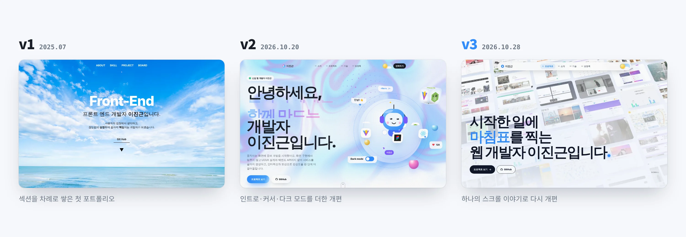

| 버전 | 시기 | 한 줄 요약 |
| :---: | :---: | :--- |
| **v1** | 2025.07 | 섹션을 위에서 아래로 차례로 쌓은 첫 포트폴리오 |
| **v2** | 2026.10.20 | 인트로·커스텀 커서·다크 모드를 더한 전체 디자인 개편 |
| **v3** | 2026.10.28 | 프로젝트를 하나의 스크롤 이야기로 보여 주는 전체 디자인 재개편 |

<details>
<summary><b>v1 — 첫 포트폴리오 (2025.07)</b></summary>
<br>

<table>
  <tr>
    <td width="33%">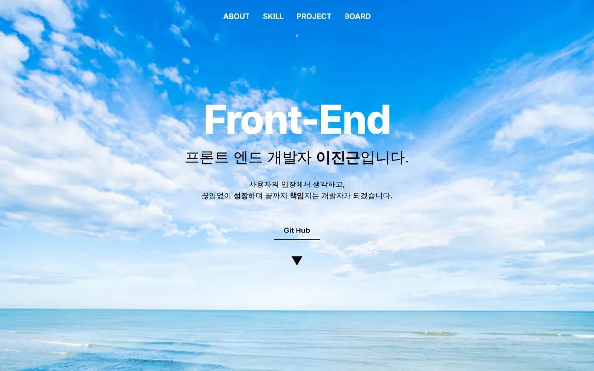</td>
    <td width="33%">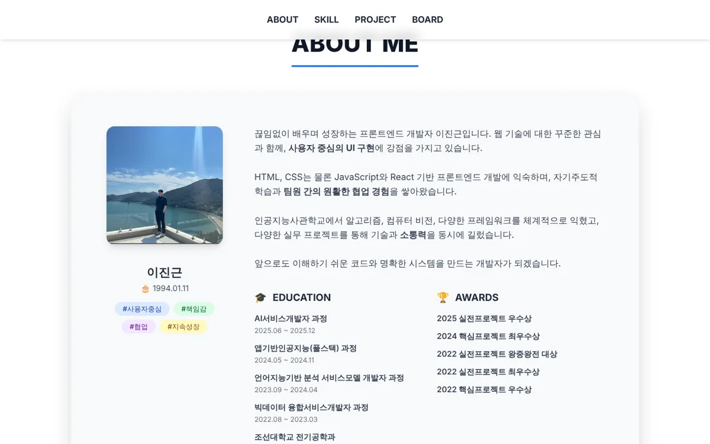</td>
    <td width="33%">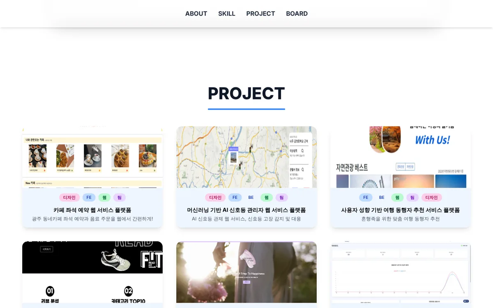</td>
  </tr>
</table>

- **구성:** 메인 → 소개(ABOUT ME) → 기술(SKILLS) → 프로젝트(PROJECT) → 마무리(Thank you) → 방명록(Board)
- **메인:** 하늘·바다 배경 사진 위에 "Front-End" 제목과 GitHub 링크
- **소개:** 프로필 사진 카드와 함께 교육 과정, 수상 내역을 목록으로 정리
- **기술:** 분야(주요 언어, 프론트엔드, 백엔드 등) 탭을 눌러 기술 카드를 보는 방식
- **프로젝트:** 카드 목록, 누르면 상세 창과 이미지 슬라이드, 시연 영상
- **방명록:** Firebase Firestore로 실시간 댓글 구현
- **움직임:** AOS 라이브러리로 스크롤할 때 요소가 나타나는 효과
- **배포:** Vercel
</details>

<details>
<summary><b>v2 — 전체 디자인 개편 (2026.10.20)</b></summary>
<br>

<table>
  <tr>
    <td width="33%">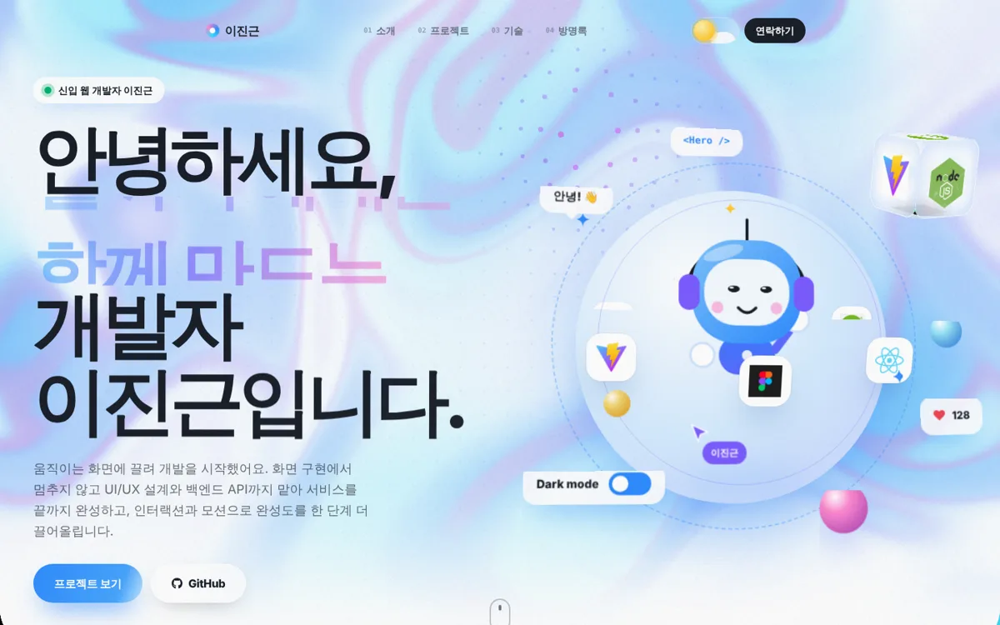</td>
    <td width="33%">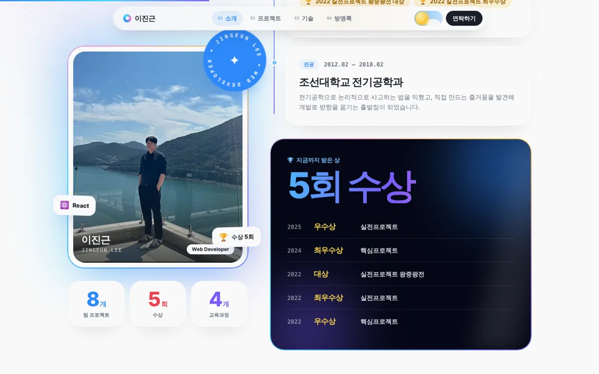</td>
    <td width="33%">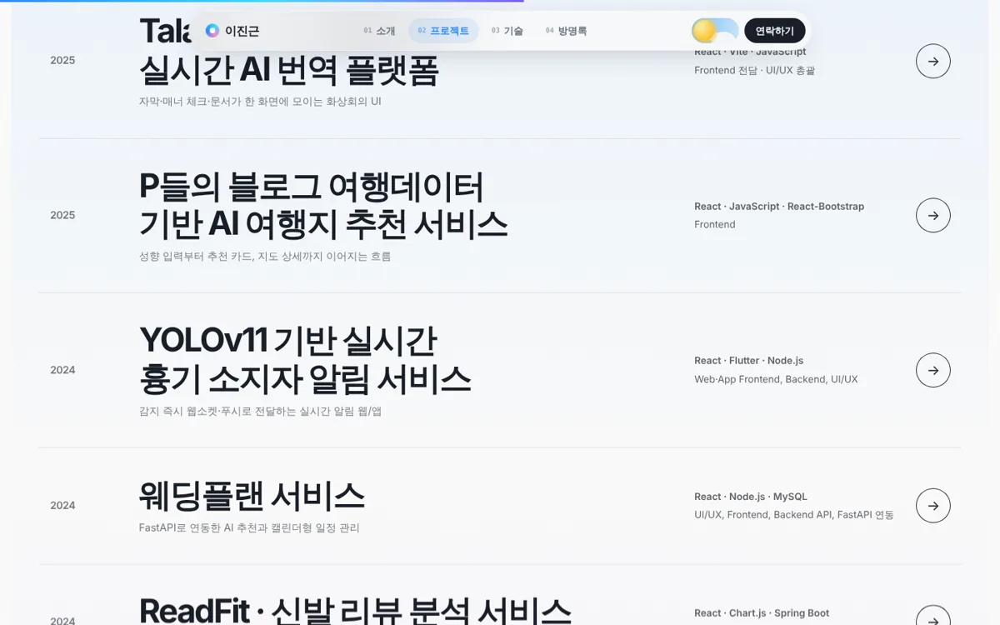</td>
  </tr>
</table>

**v1에서 달라진 점**
- **구성 변경:** 소개 → 프로젝트 → 기술 → 방명록 순서로 바꾸고, 맨 아래 푸터가 드러나는 마무리로 변경
- **새로 추가:** 새로고침할 때마다 나오는 인트로 화면, 커스텀 커서, 라이트·다크 모드, Lenis 부드러운 스크롤
- **메인:** 배경 사진 대신 움직이는 그라데이션 배경과 캐릭터 일러스트
- **소개:** 숫자 카운터(프로젝트·수상·교육 과정 수), 교육 과정 타임라인, 수상 카드
- **프로젝트:** 카드 목록에서 연도별 목록 형태로 변경
- **기술:** 기술 아이콘이 궤도를 도는 형태로 변경
- **코드 구조:** 프로젝트·소개·기술 내용을 `src/data` 폴더의 데이터 파일로 분리
- **애니메이션:** AOS 대신 Motion 라이브러리 중심으로 변경
</details>

<details open>
<summary><b>v3 — 전체 디자인 재개편 (2026.10.28)</b></summary>
<br>

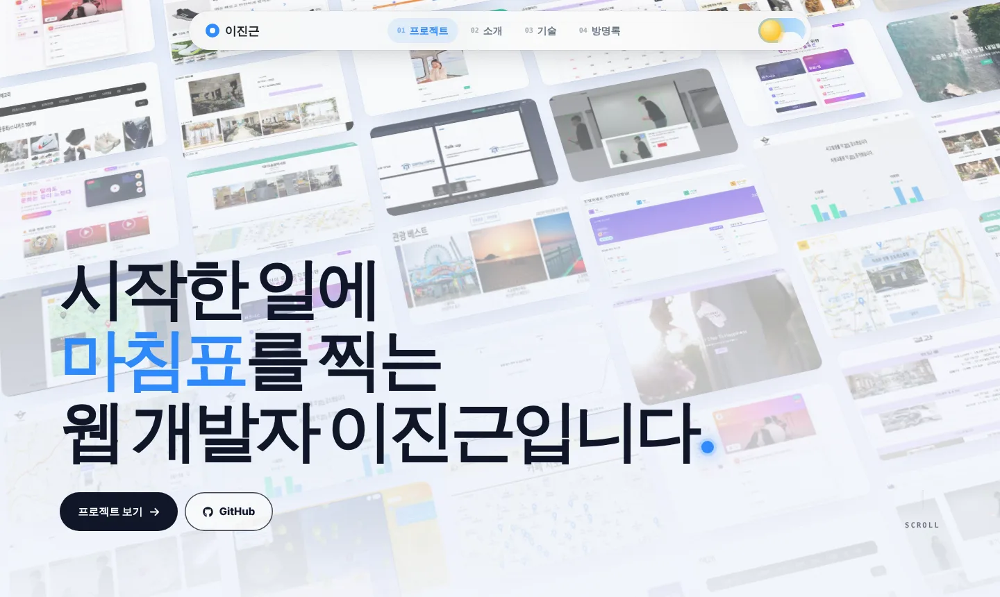

**v2에서 달라진 점**
- **흐름:** 섹션을 나열하는 방식에서, 스크롤 한 번으로 이어지는 하나의 이야기로 변경
- **프로젝트:** 목록 대신 노트북·휴대폰 화면 안에서 기능이 하나씩 바뀌는 장면으로 프로젝트마다 소개
- **새로 추가:** 섹션마다 볼 곳을 따라가는 마침표 길잡이
- **기술:** 별자리처럼 모였다가 분야별로 켜지는 장면으로 변경
- **수상:** 실제 순위(1등·2등)에 맞춰 메달 색을 나누고, 누르면 관련 프로젝트로 이동
- **모바일:** 전체 화면 메뉴(☰) 추가, 라이트·다크 모드 색 따로 지정
- **상세 창:** 해결한 문제, 요구사항 대응 섹션 추가, 기술 칩 정리
- **애니메이션:** 스크롤 장면에 GSAP ScrollTrigger 도입, 쓰지 않게 된 라이브러리(AOS, Framer Motion, Swiper, Lucide) 정리
</details>

<br>

## 🤖 제작 방식

이 사이트는 모든 버전을 **AI 도구를 활용해** 만들었습니다.

| 버전 | 활용한 도구 |
| :---: | :--- |
| v1 | ChatGPT를 많이 활용 |
| v2 · v3 | AI 코딩 도구(Claude) 활용 |

- **제가 한 일:** 사이트 구성과 흐름 기획, 들어갈 내용 작성, 프로젝트 내용이 실제와 맞는지 확인, 화면 크기별 동작 확인과 수정 요청
- **AI가 한 일:** 기획에 맞춘 코드 작성, 스타일·애니메이션 구현

사이트에 들어간 프로젝트 설명과 수상 내역은 실제 진행한 내용만 담았습니다.

<br>

## ▶ 실행 방법

Node.js 20.19 이상이 필요합니다.

```bash
npm install
npm run dev
```

방명록을 쓰려면 폴더 맨 위에 `.env` 파일을 만들고 Firebase 값을 넣습니다.
`.env`가 없어도 사이트는 열리고, 방명록만 동작하지 않습니다.

```env
VITE_FIREBASE_API_KEY=
VITE_FIREBASE_AUTH_DOMAIN=
VITE_FIREBASE_PROJECT_ID=
VITE_FIREBASE_STORAGE_BUCKET=
VITE_FIREBASE_MESSAGING_SENDER_ID=
VITE_FIREBASE_APP_ID=
VITE_FIREBASE_MEASUREMENT_ID=
```

| 명령어 | 설명 |
| :--- | :--- |
| `npm run dev` | 개발 서버 실행 |
| `npm run build` | 배포용 빌드 |
| `npm run preview` | 빌드 결과 미리보기 |

<br>

## 📁 폴더 구조

```
src/
├─ pages/          # 화면 섹션 (Story, Chapter, WebApp, MoreProjects, About, Skills …)
├─ components/     # 공통 컴포넌트 (Guide, Cursor, Navs, MobileMenu, CommentBoard …)
│  └─ Projects/    # 프로젝트 상세 창
├─ data/           # 프로젝트·소개·기술·스토리 내용 데이터
├─ lib/            # GSAP 설정, 길잡이(guide), 테마, 환경 변수
├─ firebaseConfig.jsx
└─ index.css
public/
├─ project-images/ # 프로젝트 화면 이미지
└─ story/          # 스크롤 장면용 이미지
docs/screenshots/  # README 이미지
```

<br>

<div align="center">
<sub>© 2026 이진근 · <a href="https://myportfolio-steel-delta.vercel.app">myportfolio-steel-delta.vercel.app</a></sub>
</div>
